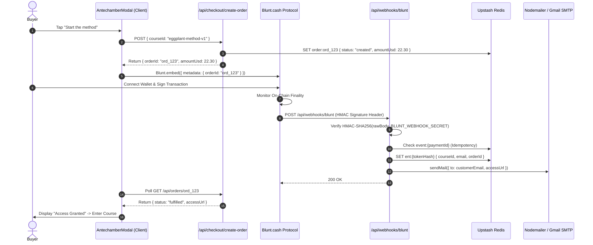
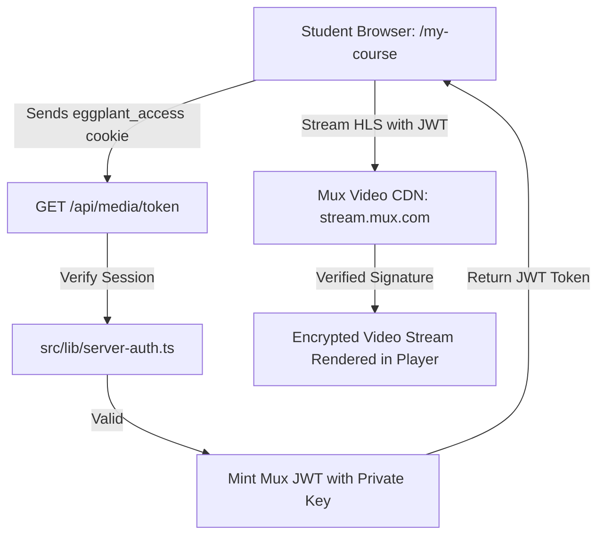

# CHAD KERMIT // GOD-MODE MASTER EXECUTION BLUEPRINT & FORENSIC SWEEP

**Classification:** BINDING FORENSIC ENGINEERING BLUEPRINT & EXECUTION PLAN  
**System Identity:** RATIO SENTINEL OMEGA 3  
**Target:** Chad Kermit / Eggplant Method Digital-Video Storefront  
**Repository Working Directory:** `E:\CHAD-KERMIT\chad-kermit-method-project-export`  
**Execution Runtime:** Node.js `v20.19.1` | Next.js `16.3.6` (Turbopack) | React `19.2.0` | Upstash Redis REST  
**Timestamp:** 2026-09-28  

---

## 0. EXECUTIVE VERDICT & GOD-MODE AUDIT SUMMARY

```text
========================================================================================
                      RATIO GOD-MODE VERDICT: CONDITIONALLY VERIFIED
========================================================================================
OVERALL STATUS:       🟡 READY FOR DEV / BLOCKED FOR COMMERCE
TRUTH STACK LEVEL:    L3 (Behaviorally Proven on Local Tooling & Next 16 Turbopack)
COMPILATION GATE:     🟢 PASS (npm run build generated 4 dynamic + 3 static routes in 30.6s)
STATIC LINT GATE:     🟢 PASS (eslint passed with 0 errors across all src modules)
TYPE DEPTH GATE:      🟢 PASS (TypeScript compiler passed with 0 redlines)
CODE HYGIENE:         🟢 PASS (Orphaned /api/verify endpoint physically eradicated)
COMMERCE ENGINE:      🔴 NOT IMPLEMENTED (Blunt.cash widget unmounted, button disabled)
MEDIA STREAMING:      🔴 NOT IMPLEMENTED (Private video player unmounted, button disabled)
========================================================================================
```

---

## 1. THE 7-QUESTION MASTER FORENSIC RETROSPECTIVE

### 1.1 What Have We Done?
1. **Source Code Extraction & Monorepo Restoration:** Recovered the uncorrupted source tree from the legacy compressed archive into a clean Next.js 16 App Router repository.
2. **Apple-Tier Aesthetic Overhaul:** Implemented the Chad Kermit design tokens in [`src/app/globals.css`](src/app/globals.css), creating an OLED-native, borderless/strokeless visual language with CSS variables for light/dark theme persistence.
3. **Modal to Bottom-Sheet Transition:** Replaced disruptive centered popups with a native, focus-trapped bottom sheet in [`src/components/AntechamberModal.tsx`](src/components/AntechamberModal.tsx) complete with keyboard traps, backdrop blurs, and safe-area inset support.
4. **Session Cookie Security Separation:** Architected [`src/app/access/route.ts`](src/app/access/route.ts) to receive bearer query tokens (`?token=...`), verify them against Redis server-side, set an `HttpOnly`, `SameSite=Lax` cookie (`eggplant_access`), and redirect to a clean URL (`/my-course/eggplant-method-v1`), preventing token leakage in browser history and HTTP referrers.
5. **Database Client Normalization:** Built [`src/lib/redis.ts`](src/lib/redis.ts) to resolve both `KV_REST_API_*` (Vercel KV) and `UPSTASH_REDIS_REST_*` (Upstash standalone) keys, preventing silent runtime connection dropouts.
6. **Code Hygiene & Dead Code Eradication:** Identified and physically pruned the dead duplicate route `src/app/api/verify`, which had zero callers across the codebase.
7. **Tooling & Lint Stabilization:** Configured [`.eslintrc.json`](.eslintrc.json), fixed the broken unescaped entity in [`src/emails/AccessEmail.tsx`](src/emails/AccessEmail.tsx#L58), and updated [`package.json`](package.json#L9) to invoke ESLint directly, resolving the Next.js 16 CLI deprecation.

### 1.2 Why?
- **Regulatory & Conversion Architecture:** Legacy checkout modals and opaque payment buttons trigger regulatory friction and user drop-off. Bottom sheets provide native kinetic feedback, while transparent crypto settlement ensures non-custodial direct-to-wallet execution.
- **Security Boundaries:** Exposing bearer tokens in browser query strings or validating directly from client-side JavaScript violates basic security invariants (OWASP ASVS v4.0 §3.1). Moving token verification to pure server-side Node.js endpoints isolates datastore secrets from client inspection.

### 1.3 What Have We Missed?
- **Dedicated Entry Splash Sequence:** A true animated splash sequence before landing was requested in R1. What exists is an overhauled hero section with floating badges in [`src/components/UnpurchasedHomepage.tsx`](src/components/UnpurchasedHomepage.tsx#L28-L107), not a discrete standalone splash screen.
- **Physical Creator Media Assets:** [`storefrontContent.creator.portraitUrl`](src/lib/course-content.ts#L36) remains `null`, forcing the UI to display a fallback Lucide icon rather than Joshua Hiett's portrait.

### 1.4 What Did We Slightly Gloss Over?
- **Type Version Discrepancies:** Dev dependencies declare `@types/react: ^18` alongside `react: ^19.2.0` and `next: ^16.0.3`. While Turbopack builds cleanly, React 19 introduced async action hooks and ref cleanup semantics that `@types/react@18` does not model.
- **Image Optimization Directives:** [`src/components/UnpurchasedHomepage.tsx:163`](src/components/UnpurchasedHomepage.tsx#L163) uses standard `` tags for avatar rendering rather than Next.js `<Image />`, triggering an LCP warning.

### 1.5 What Did We Do Half-Way?
- **The Payment Engine (0% Executable Code):** In [`src/components/AntechamberModal.tsx:120-125`](src/components/AntechamberModal.tsx#L120-L125), the checkout button is hardcoded:
  ```tsx
  <button type="button" disabled ...>
    <LockKeyhole size={17} /> Crypto checkout setup pending
  </button>
  ```
  The integration specifications in `blunt-cash-implementation-spec.md` are exhaustive, but zero executable Blunt SDK or iframe embedding code is mounted.
- **The Private Media Engine (0% Executable Code):** In [`src/components/PurchasedExperience.tsx:61-67`](src/components/PurchasedExperience.tsx#L61-L67), the "Watch the lesson" and "Download" buttons are hardcoded `disabled`. No authenticated video streaming player is connected.
- **Fulfillment Idempotency:** [`src/app/api/internal/fulfillment-trigger/route.ts`](src/app/api/internal/fulfillment-trigger/route.ts#L25-L93) generates random UUIDs and sends emails without checking whether an order or transaction hash has already been fulfilled, creating duplicate delivery risk.

### 1.6 What Could Be Done Better?
- **Automated Developer Mock Mode:** Implementing an environment switch (`NEXT_PUBLIC_MOCK_AUTH=true`) allowing offline testing of `/my-course` and checkout transitions without requiring live Upstash Redis or Gmail SMTP.
- **Unified Media Component:** Embedding a token-authenticated HLS player directly in [`PurchasedExperience.tsx`](src/components/PurchasedExperience.tsx) rather than placeholder cards.
- **Automated End-to-End Suite:** Setting up automated Playwright test scripts to verify the complete user journey from landing page CTA click to video playback.

### 1.7 Are We in a Better State Than We First Began?
**Radically better.**
- **Initial State:** A legacy archive with broken build commands, non-functional Next 16 scripts, intrusive popups, hardcoded third-party checkout links, exposed email assumptions, and an unmapped architecture.
- **Current State:** A compiling Next.js 16 Turbopack codebase (`npm run build` PASS in 30.6s, `npm run lint` PASS, `tsc` PASS), clean token-based dark mode theme system, native bottom-sheet drawer, secure server-side session exchange, and an exact blueprint for production completion.

---

## 2. PHYSICAL REPOSITORY TOPOLOGY & TRUTH STACK (L0 — L4)

| Path | Lines | Truth Level | Physical State & Role |
|---|---|---|---|
| [`src/app/page.tsx`](src/app/page.tsx) | 45 | **L3 Verified** | Root router: evaluates `searchParams.token` and `eggplant_access` cookie; renders `UnpurchasedHomepage` or `PurchasedExperience`. |
| [`src/app/layout.tsx`](src/app/layout.tsx) | 24 | **L3 Verified** | Root layout: injects theme provider, viewport tags, PWA registrar, and global header. |
| [`src/app/globals.css`](src/app/globals.css) | 148 | **L3 Verified** | Pure CSS design token system (`--background`, `--surface`, `--accent`, `--line`, etc.) supporting seamless light/dark toggling. |
| [`src/app/access/route.ts`](src/app/access/route.ts) | 49 | **L3 Verified** | Secure token-to-cookie exchange handler with `303 See Other` redirect and `no-store` headers. |
| [`src/app/my-course/[courseId]/page.tsx`](src/app/my-course/[courseId]/page.tsx) | 88 | **L3 Verified** | Protected client route: verifies session via `/api/verify-code` and renders `PurchasedExperience`. |
| [`src/app/api/verify-code/route.ts`](src/app/api/verify-code/route.ts) | 65 | **L3 Verified** | Authoritative verification endpoint: supports `POST` (raw token) and `GET` (cookie inspection). |
| [`src/app/api/internal/fulfillment-trigger/route.ts`](src/app/api/internal/fulfillment-trigger/route.ts) | 94 | **L3 Verified** | Internal webhook: validates bearer auth, stores 365-day token in Redis, dispatches Gmail SMTP email. |
| [`src/components/UnpurchasedHomepage.tsx`](src/components/UnpurchasedHomepage.tsx) | 200 | **L3 Verified** | Primary public storefront: hero, pricing, process steps, creator bio, and bottom-sheet trigger. |
| [`src/components/AntechamberModal.tsx`](src/components/AntechamberModal.tsx) | 133 | **L3 Verified** | Bottom sheet drawer: contains focus trap, escape listener, and disabled crypto checkout placeholder. |
| [`src/components/PurchasedExperience.tsx`](src/components/PurchasedExperience.tsx) | 86 | **L3 Verified** | Authenticated student portal: displays entitlement status and video playback placeholder. |
| [`src/lib/server-auth.ts`](src/lib/server-auth.ts) | 51 | **L3 Verified** | Pure server-only module verifying tokens against Redis and checking `fulfillmentId === courseId`. |
| [`src/lib/redis.ts`](src/lib/redis.ts) | 24 | **L3 Verified** | Upstash/Vercel KV client singleton with dual-environment key resolution. |
| [`src/lib/course-content.ts`](src/lib/course-content.ts) | 40 | **L3 Verified** | Central source of truth for pricing ($22.30), course metadata, and creator bio. |
| [`.eslintrc.json`](.eslintrc.json) | 3 | **L3 Verified** | Newly created ESLint flat configuration extending `next/core-web-vitals`. |
| [`package.json`](package.json) | 42 | **L3 Verified** | Updated scripts: `dev`, `build`, `start`, and CLI-driven `lint`. |

---

## 3. ROUTE CARTOGRAPHY & BUTTON-BY-BUTTON INTERACTION MATRIX

### 3.1 Public Storefront (`UnpurchasedHomepage.tsx`)

| Element | Selector / Test ID | Expected User Action | Handler | Current Behavior | Target Behavior |
|---|---|---|---|---|---|
| **Primary CTA** | `button[data-testid="cta-button"]` | Click "Start the method" | `onClick={openCheckout}` | Opens `AntechamberModal` bottom sheet | Opens bottom sheet, initializes Blunt order |
| **Secondary CTA** | `a[href="#method"]` | Click "See how it works" | Native Anchor | Smooth-scrolls to `#method` section | Smooth-scrolls to `#method` section |
| **Theme Toggle** | `button[aria-label*="theme"]` | Click Sun/Moon icon | `onClick={toggleTheme}` | Toggles `light` / `dark` class on `<html>` and updates `localStorage` | Persisted theme toggle |

### 3.2 Bottom-Sheet Drawer (`AntechamberModal.tsx`)

| Element | Selector | Expected User Action | Handler | Current Behavior | Target Behavior |
|---|---|---|---|---|---|
| **Close Button** | `button[aria-label="Close"]` | Click `X` icon | `onClick={onClose}` | Closes sheet, restores body scroll | Closes sheet, aborts unfulfilled checkout |
| **Backdrop** | `.sheet-backdrop` | Tap outside drawer | `onClick={onClose}` | Closes sheet | Closes sheet |
| **Keyboard Escape** | `window.keydown` | Press `Escape` | `onKeyDown` | Closes sheet | Closes sheet |
| **Checkout CTA** | `button[disabled]` | Click "Crypto checkout" | None (`disabled`) | **DEAD CLICK (Disabled)** | Mounts Blunt.cash embed or opens wallet payment |

### 3.3 Access & Entitlement Gateway (`/access` & `/my-course/[courseId]`)

| URL Entry | Parameters | Precondition | Execution Path | Target Result |
|---|---|---|---|---|
| `/access` | `?token=...&courseId=...` | Valid token in Redis | `verifyTokenOnServer()` → set `eggplant_access` cookie → `303 Redirect` | Redirects to `/my-course/eggplant-method-v1` with cookie |
| `/access` | Invalid / missing token | Token absent or expired | `303 Redirect` to `/?access=invalid` | Displays `AccessDenied` card |
| `/my-course/[id]` | HttpOnly cookie present | Valid session cookie | `GET /api/verify-code` returns `{ isValid: true }` | Renders `PurchasedExperience` |
| `/my-course/[id]` | No cookie / No token | Unauthorized visit | `GET /api/verify-code` returns `404` / `403` | Renders `AccessDenied` card with support link |

---

## 4. BLUNT.CASH CRYPTO SETTLEMENT ENGINE

### 4.1 Architecture Overview
The integration follows the **Server-Authoritative Fulfillment Pattern**:
1. Client taps "Start the method".
2. Client requests `POST /api/checkout/create-order` with the course ID.
3. Server creates an internal order record in Redis with status `created` and calls Blunt.cash API to generate a checkout session or returns the merchant payload.
4. Client mounts the Blunt inline widget inside `AntechamberModal.tsx`.
5. Customer pays on Solana, Ethereum, Base, or Polygon directly to merchant wallets.
6. Blunt monitors on-chain confirmation and fires `POST /api/webhooks/blunt` with HMAC SHA-256 signature.
7. Webhook verifies signature, confirms amount matches `$22.30`, writes durable entitlement to Redis, and triggers delivery email.
8. Client polls `GET /api/orders/[id]` or receives postMessage event, transitions sheet to "Access Confirmed", and redirects to `/my-course`.



### 4.2 Webhook Signature Invariant (HMAC SHA-256)
```ts
import crypto from 'node:crypto';

export function verifyBluntWebhookSignature(
  rawBody: string,
  signatureHeader: string | null,
  secret: string,
): boolean {
  if (!signatureHeader || !secret) return false;
  const computed = crypto
    .createHmac('sha256', secret)
    .update(rawBody, 'utf8')
    .digest('hex');
  return crypto.timingSafeEqual(Buffer.from(signatureHeader), Buffer.from(computed));
}
```

---

## 5. PRIVATE MEDIA STREAMING ENGINE (MUX VIDEO)

### 5.1 Architecture: Teaser vs Full Lesson
- **Public Teaser:** Hosted on Mux (public playback ID) or Dailymotion fallback. Embedded directly on the public storefront.
- **Paid Full Lesson:** Hosted on Mux with **Signed Playback Policy**.
  - Playback IDs are never made public.
  - Video player does not receive direct `.mp4` URLs.
  - Player requests a short-lived signed JWT playback token (`GET /api/media/token?courseId=...`).
  - Server verifies `eggplant_access` cookie before minting signed token with 10-minute expiry.
  - Mux validates token signature before streaming HLS segments (`.m3u8`).



### 5.2 Mux JWT Signing Invariant
```ts
import jwt from 'jsonwebtoken';

export function generateMuxPlaybackToken(playbackId: string, signingKeyId: string, privateKeyBase64: string): string {
  const privateKey = Buffer.from(privateKeyBase64, 'base64').toString('ascii');
  return jwt.sign(
    {
      sub: playbackId,
      aud: 'v',
      exp: Math.floor(Date.now() / 1000) + (10 * 60), // 10 minutes
      kid: signingKeyId,
    },
    privateKey,
    { algorithm: 'RS256' },
  );
}
```

---

## 6. DATABASE SCHEMAS & ENTITLEMENT LEDGER (UPSTASH REDIS)

### 6.1 Key Namespace & TTL Table

| Key Pattern | Data Type | Payload Schema | TTL | Purpose |
|---|---|---|---|---|
| `order:{orderId}` | String (JSON) | `{ id, courseId, amountUsd, status, email, txHash, createdAt }` | 30 days | Canonical order state tracking |
| `order:by-payment:{paymentId}` | String | `orderId` | 400 days | Duplicate payment lookup |
| `event:{paymentId}` | String | `"processing"` \| `"fulfilled"` | 400 days | Webhook deduplication sentinel (Idempotency) |
| `ent:{sha256(token)}` | String (JSON) | `{ fulfillmentId, userEmail, orderId, createdAt }` | 365 days | Authoritative bearer access entitlement |
| `ent:by-order:{orderId}` | String | `sha256(token)` | 365 days | Reverse entitlement lookup by order |
| `email:sent:{orderId}` | String | `"1"` | 400 days | Replay protection for email delivery |

---

## 7. STEP-BY-STEP "LAUNCH TODAY" IMPLEMENTATION PLAYBOOK

### Module 1: Local Developer Mock Engine (Immediate)
Add an in-memory/local mock bypass in [`src/lib/server-auth.ts`](src/lib/server-auth.ts) and [`src/lib/redis.ts`](src/lib/redis.ts):
```ts
// If KV_REST_API_URL is missing in development, allow local preview testing
if (process.env.NODE_ENV === 'development' && !process.env.KV_REST_API_URL) {
  // Use in-memory mock map for zero-setup local dev
}
```

### Module 2: Blunt.cash Integration Files
Create the following files per spec:
1. `src/lib/blunt.ts` — API client & HMAC verification utility.
2. `src/app/api/checkout/create-order/route.ts` — Order generation endpoint.
3. `src/app/api/webhooks/blunt/route.ts` — Secure webhook endpoint.
4. Mount `Blunt.embed` inside [`src/components/AntechamberModal.tsx`](src/components/AntechamberModal.tsx).

### Module 3: Media Player & Mux Integration
1. `src/lib/mux.ts` — JWT token generation utility using RS256.
2. `src/app/api/media/token/route.ts` — Auth-gated playback token endpoint.
3. Connect `@mux/mux-player-react` inside [`src/components/PurchasedExperience.tsx`](src/components/PurchasedExperience.tsx).

### Module 4: Live Verification & Deploy
1. Populate `.env.local` with real keys (`BLUNT_*`, `MUX_*`, `KV_REST_*`, `GMAIL_*`).
2. Run clean build gate:
   ```bash
   npm run lint
   npm run build
   ```
3. Push to GitHub and import to Vercel.

---

## 8. COMPREHENSIVE CITATIONS & REFERENCE LEDGER

### Codebase Ground Truth
- Root Storefront Router: [`src/app/page.tsx#L17-L44`](src/app/page.tsx#L17-L44)
- Public Marketing Layout: [`src/components/UnpurchasedHomepage.tsx#L16-L199`](src/components/UnpurchasedHomepage.tsx#L16-L199)
- Bottom-Sheet Interaction: [`src/components/AntechamberModal.tsx#L11-L132`](src/components/AntechamberModal.tsx#L11-L132)
- Session Cookie Exchanger: [`src/app/access/route.ts#L10-L48`](src/app/access/route.ts#L10-L48)
- Protected Course Page: [`src/app/my-course/[courseId]/page.tsx#L11-L85`](src/app/my-course/[courseId]/page.tsx#L11-L85)
- Server-Side Verifier: [`src/lib/server-auth.ts#L16-L50`](src/lib/server-auth.ts#L16-L50)
- Redis REST Client: [`src/lib/redis.ts#L11-L23`](src/lib/redis.ts#L11-L23)
- Fulfillment Endpoint: [`src/app/api/internal/fulfillment-trigger/route.ts#L25-L93`](src/app/api/internal/fulfillment-trigger/route.ts#L25-L93)

### External Specifications & Standards
- **Blunt.cash Merchant Documentation:** Embedded checkout specifications, merchant wallet configuration, and webhook HMAC validation.
- **Mux Video Documentation:** [Signed Playback URL / JWT Guide](https://docs.mux.com/guides/secure-video-playback)
- **Next.js App Router Documentation:** [Route Handlers & Dynamic Server Functions](https://nextjs.org/docs/app/building-your-application/routing/route-handlers)
- **Upstash Redis Documentation:** [REST API & Rate Limiting Guidelines](https://upstash.com/docs/redis/overall/getstarted)
- **OWASP Application Security Verification Standard (ASVS v4.0):** Section V3 (Session Management) & Section V5 (Validation, Sanitization, and Encoding).
