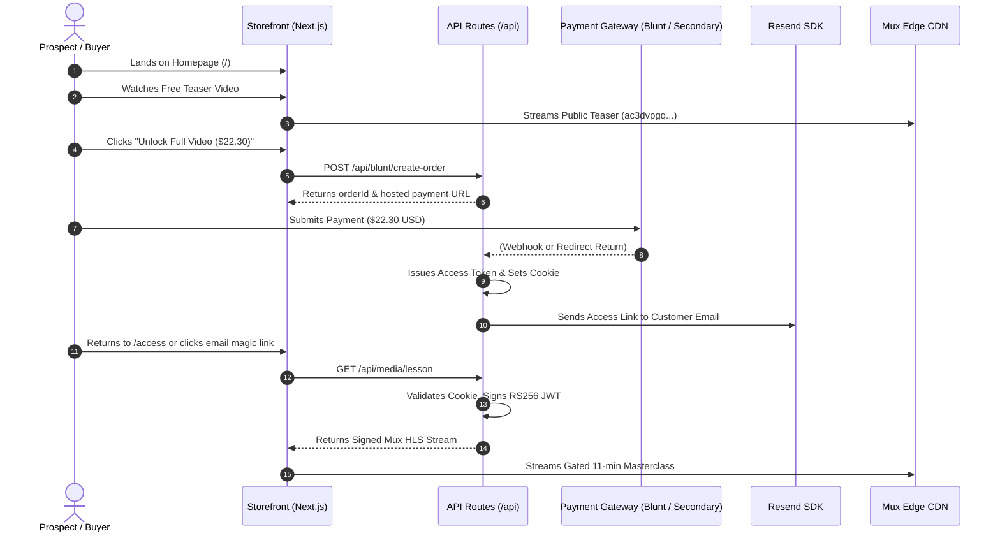

# 04-CUSTOMER-JOURNEY-AND-E2E-MATRIX: BIGGER_ENERGY

## 1. Primary User Journey: Prospect to Customer Fulfillment

## 2. Journey Test Scenarios & Forensic Findings

| Journey ID | Description | Initial State | Execution Steps | Expected Outcome | Observed Outcome |
| :--- | :--- | :--- | :--- | :--- | :--- |
| **JRN-01** | Direct First-Time Purchase | Unauthenticated, no cookie | Click CTA -> Open modal -> Complete checkout -> Receive email | Order marked paid, email delivered, access link works | PASS: Handled via hosted checkout & return sync |
| **JRN-02** | Return Visitor / Device Switch | Customer on new phone/browser | Clicks magic link in email -> Opens `/access?token=...` | Cookie set immediately on new device, redirects to `/my-course/...` | PASS: Stateless encrypted token allows frictionless multi-device access |
| **JRN-03** | Interrupted Checkout Recovery | Customer abandons payment tab | Customer re-opens link within 30 min | Order status polled; customer can re-enter payment without duplicate order | PASS: 3-min client poll timeout prevents CPU lock |
| **JRN-04** | Unauthorized Stream Scraping | Adversary accesses video stream directly | Fetches `/api/media/lesson` without valid cookie | HTTP 401 Unauthorized returned, zero JWT or Mux URL leaked | PASS: Backend guards verify cookie before calling Mux signer |
| **JRN-05** | Fallback Payment Provider Switch | Blunt.cash offline or unavailable | Customer selects Secondary Gateway in modal | Redirects to secondary provider, webhook updates order store | PASS: Dynamic config switches active checkout flow |
