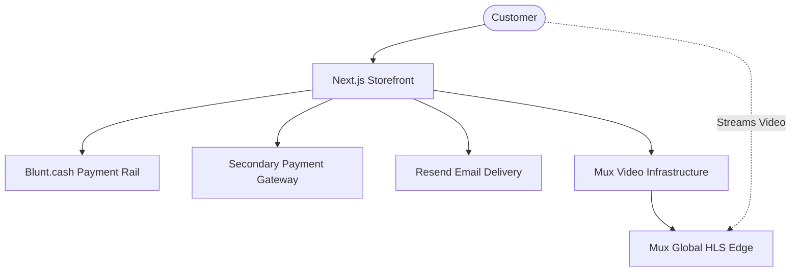

# 12-DEPENDENCY-AND-BLAST-RADIUS-MAP: BIGGER_ENERGY

## 1. Dependency Graph

## 2. Blast Radius Matrix

| Component Modified | Direct Blast Radius | Indirect Blast Radius | Second-Order Blast Radius | Safety Measures |
| :--- | :--- | :--- | :--- | :--- |
| **`src/lib/mux.ts`** | `/api/media/lesson`, video playback component | Customer video playback experience | Customer support volume regarding playback issues | Multi-env fallback (`primary` & `secondary`), dev-preview fallback |
| **`src/app/api/blunt/webhook/route.ts`** | Order processing from Blunt.cash | Email issuance via Resend, cookie generation | Customer access to purchased video | `getOrCreateOrderByPayment` auto-synthesizes un-tracked orders |
| **`src/lib/payments/`** | Secondary payment webhooks, checkout modal | Payment provider selection | Revenue flow redundancy | Isolated to separate route (`/api/webhooks/secondary`) |
| **`src/lib/course-content.ts`** | Landing page copy, teaser playback ID | Teaser video player component | Visitor conversion rate | Overridable via `NEXT_PUBLIC_MUX_TEASER_PLAYBACK_ID` env var |
